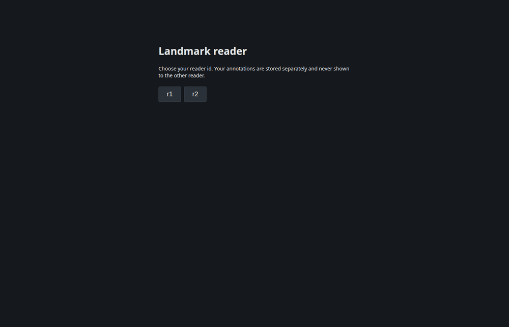
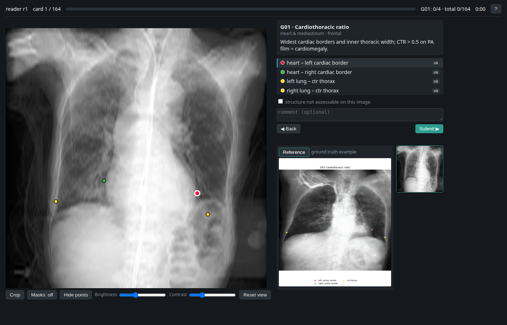
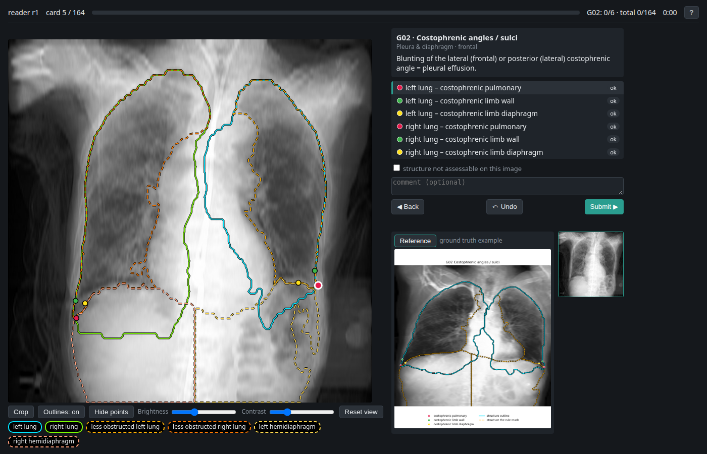
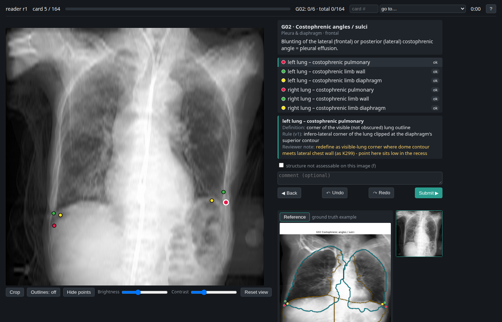
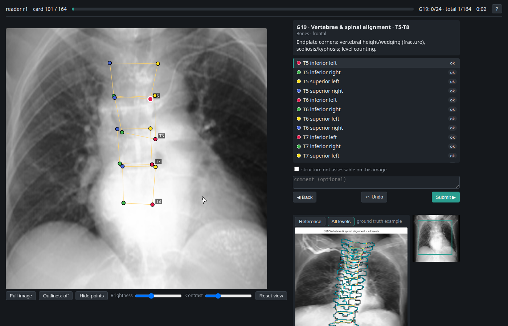
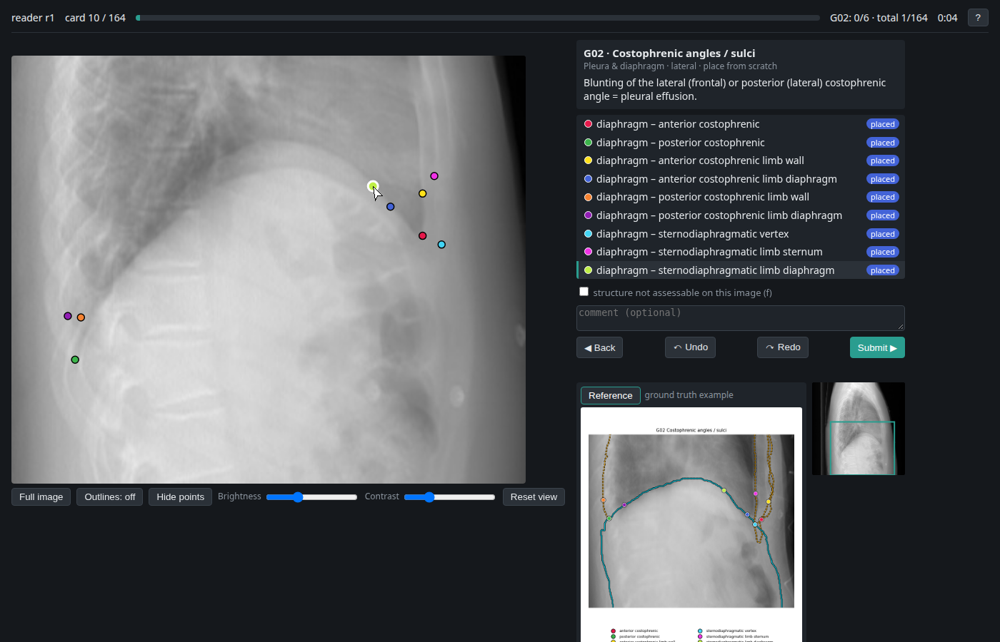
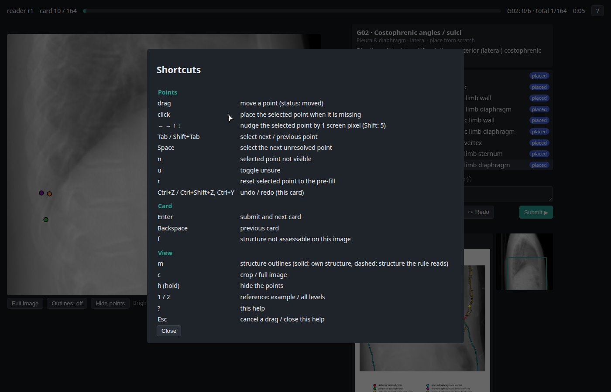
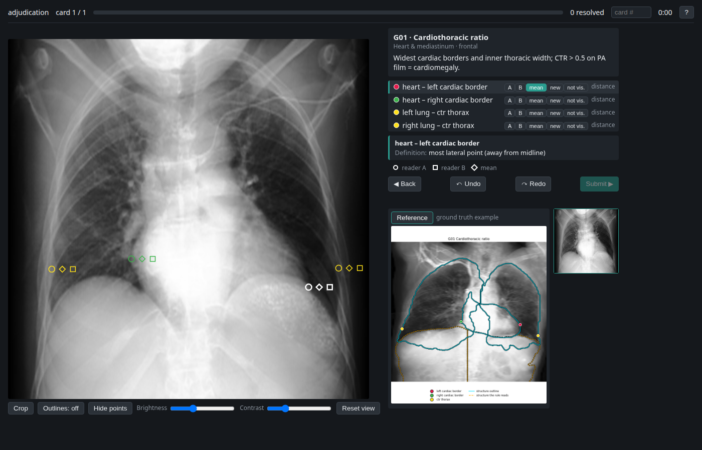

# cxr-landmark-reader

A small local web app in which two readers correct pre-filled anatomical landmarks on chest
radiographs, card by card. The result is a gold standard, per-landmark inter-reader tolerances
(the σ of an object-keypoint-similarity metric), and an agreement report.



> **Data use.** The app is built for credentialed data such as MIMIC-CXR. It only binds to
> localhost, serves images by opaque index and never shows image identifiers. This repository
> holds code only; the demo, screenshots and browser tests use open PAXRay++ images. Study
> folders, exports and bundles contain image identifiers (and, with `--with-images`, the images):
> keep them on machines covered by the data use agreement — never on GitHub or cloud storage.

**Contents:** [Install](#install) · [1 Get a study](#1-get-a-study) · [2 Read](#2-read) ·
[For readers](#for-readers-reading-on-your-own-machine) ·
[3 Export](#3-export-at-any-time) · [4 Import readers' work](#4-import-readers-work) ·
[5 Aggregate and adjudicate](#5-aggregate-adjudicate-finalise) · [6 Move a study](#6-move-a-study) ·
[Testing](#testing) · [Files](#files-and-formats)

---

## Install
Python 3.10–3.12.
```bash
git clone git@github.com:ConstantinSeibold/cxr-landmark-reader.git && cd cxr-landmark-reader
pip install -r requirements.txt

# browser tests and demo recording only
pip install playwright
python -m playwright install chromium          # headless Chromium (~120 MB, cached in ~/.cache/ms-playwright)
```

## 1 Get a study
A *study* is one folder (`$DATA`) plus the images it refers to (`$IMAGE_ROOT`):
```
$DATA/
  static/     vocab.json  definitions.json  categories.json   landmark vocabulary, groups, definitions
  refs/       G##_<view>[_series].png  refs_manifest.json     ground-truth reference image per group
  prefill/<version>/<image id>.json                           pre-filled points + structure masks
  cards.json                                                  frozen card list (sha) + image list
  readers/<reader>/decisions.jsonl, state.json                created while reading
  exports/<reader>/<time>/                                    created by exports
```

### a) Unpack a study someone sent you
```bash
python -m goldkp.project unpack --zip study.zip --to $DATA --images $IMAGE_ROOT   # your local copy of the images
python -m goldkp.project unpack --zip study.zip --to $DATA                        # bundle that includes the images
```
Every image is checked against the checksum recorded when the study was packed; missing or
different files are reported and the command exits with an error. Then go to [2 Read](#2-read).

### b) Build a study from sources
Inputs: `KP_PREP` (the landmark definitions: taxonomy and extraction rules), the PAXRay++
keypoint files (`$PAXRAY`), a `selection.csv` (`dicom_id, path, image` = frontal|lateral,
`no_prefill`), model predictions for the selected images (`preds.pkl`), and the MIMIC-CXR metadata.
```bash
python build/build_vocab.py   --kp-prep $KP_PREP --out $DATA/static \
       --categories $PAXRAY/annotations/test_kp_v1.json
python build/render_refs.py   --vocab $DATA/static/vocab.json \
       --kp-json $PAXRAY/annotations/val_kp_v1.json --image-root $PAXRAY --out $DATA/refs
python build/build_prefill.py --kp-prep $KP_PREP --selection selection.csv --preds preds.pkl \
       --v0-json $PAXRAY/annotations/test_kp.json --vocab $DATA/static/vocab.json \
       --metadata mimic-cxr-2.0.0-metadata.csv.gz --source hybrid \
       --out $DATA/prefill/hybrid_v1 --version hybrid_v1
python build/build_cards.py   --selection selection.csv --prefill $DATA/prefill/hybrid_v1 \
       --vocab $DATA/static/vocab.json --out $DATA/cards.json
```
- **Pre-fill sources:** `hybrid` uses the model's learned landmark where its definition is unchanged
  and the side labels are consistent, otherwise the final rules applied to the model's predicted
  masks; `rules_v0masks` uses the rules everywhere; `v1_learned` a model trained on the final
  vocabulary. The masks of each landmark's own structure *and* of the structures its rule reads
  are stored for the outline overlay.
- **Cards:** one image × one landmark group; vertebrae split into T1–4 / T5–8 / T9–12 / L1–2,
  ribs by side and level. Each card has a crop around its structures' masks (identical with or
  without pre-fill); groups that need the whole thorax are shown whole.
- **Freeze before reading:** the card list (`sha`) and pre-fill version are recorded with every
  answer; the server refuses to resume a reader on a different version
  (`--allow-version-change` overrides).

Check a study at any time: `python -m goldkp.project verify --data $DATA --images $IMAGE_ROOT`.

## 2 Read
```bash
python -m goldkp.server --data $DATA --images $IMAGE_ROOT --readers r1,r2 --port 8765
```
Open <http://127.0.0.1:8765> and pick your reader id. The server only binds to loopback; remote
readers use an SSH tunnel: `ssh -L 8765:localhost:8765 user@server`, then <http://localhost:8765>.
Use a separate reader id (e.g. `--readers pilot`) for a pilot so it never mixes with r1/r2.

| | |
|---|---|
|  |  |
|  |  |
|  |  |

**On every card**
- **Image:** the zoomed crop (aspect-corrected; coordinates are stored in the 512 px frame) and a
  whole-image thumbnail marking the crop. `View: zoomed / whole image` (`c`) switches; it is
  disabled on cards that are always shown whole.
- **Points:** coloured as in the reference; series points carry their level (T5, 7R, …).
- **Outlines** (`m`): solid = the landmark's own structure, dashed = a structure its rule reads
  (e.g. the visible lung for the costophrenic vertex); a legend names them. On real images these
  are the predicted masks the pre-fill rules ran on.
- **Reference:** a ground-truth example of the group (PAXRay++), same colours; vertebra and rib
  groups also show *all levels* (`2`).
- **Definition panel:** for the selected point — a plain-language definition
  (`build/reader_definitions.csv`, matched by view, structure and landmark), the technical
  construction rule and the reviewers' note. Hovering a point in the list shows the same text.
- **Status per point:** `ok` (pre-fill accepted) · `moved` · `placed` (was missing) ·
  `not visible` · optional `unsure`. A card can only be submitted when every point is resolved.
- **Scratch cards** (images flagged `no_prefill`, the anchoring check): no points are shown; a
  "Place: …" banner walks through the landmarks, each click places the next one.
- **Not assessable** (`f`): marks the whole structure as not visible on this image; add a comment
  if useful.
- **Order:** group by group (clinical groups first, then vertebrae and ribs, then zones, vessel
  and abdominal points), frontal before lateral, images shuffled per reader. With
  `--image-blocks 10,5` the server instead finishes the first 10 images in full, then blocks of 5
  (same images for every reader, same order inside a block). With `--subset 30,20` every group is
  first read on the same 30 frontal and 20 lateral images for every reader (own order per reader),
  then on the rest; `--group-order G13,G12,...` puts these groups first. Every submit is saved
  immediately; the session resumes at the first unfinished card.
- **Navigation:** card number box (type a number, Enter) and the `go to…` menu (first card of every
  group with progress, first scratch card) in the header; Back / Submit pinned at the bottom of
  the side panel. Undo / redo sit at the start of the toolbar above the image.
- **Blinding:** readers only ever see their own answers.

**Keyboard** (`?` shows this in the app)

| Points | | Card | | View | |
|---|---|---|---|---|---|
| drag | move a point | Enter | submit, next card | `m` | structure outlines |
| click | place the selected missing point | Backspace | previous card | `c` | zoomed / whole image |
| ← → ↑ ↓ | nudge 1 screen px (Shift: 5) | `f` | not assessable | hold `h` | hide the points |
| Tab / Shift+Tab | next / previous point | `g` | go to card number | `[` / `]` | brightness down / up |
| Space | next unresolved point | Ctrl+S | export a snapshot | `{` / `}` | contrast down / up |
| `n` / `u` / `r` | not visible / unsure / reset to pre-fill | | | `0` | reset brightness, contrast |
| Ctrl+Z | undo (this card) | | | `1` / `2` | reference: example / all levels |
| Ctrl+Shift+Z, Ctrl+Y | redo | | | `?` | help |
| | | | | Esc | cancel a drag, close help |

## 3 Export (at any time)
Finished or not:
- **In the app:** *Export* in the header (Ctrl+S) saves the current reader's annotations on the server and
  shows the folder.
- **Command line:** `python -m goldkp.export --data $DATA --readers r1,r2`

Each export goes to `$DATA/exports/<reader>/<time>/`:

| File | Content |
|---|---|
| `annotations.csv` | one row per landmark of every answered card: status, unsure, x/y (512 frame), pre-fill and its source, card flag, time |
| `annotations_by_image.json` | `{image id: {class: {landmark: [x, y, v, status, unsure]}}}` |
| `annotations_coco.json` | COCO keypoints with the gold categories; unanswered or not-visible landmarks have v = 0; no pixels or paths (loads in pycocotools / CVAT) |
| `summary.json` | progress per group and view, versions, whether the reading is complete |
| `decisions.jsonl` | the reader's raw log — lossless, importable (next section) |

## 4 Import readers' work
When a reader worked on another copy of the study (their own machine, an earlier session), merge
their answers into the main study:
```bash
python -m goldkp.project import-reader --data $DATA --source <export folder | decisions.jsonl | other study> --rid r1
python -m goldkp.project import-reader --data $DATA --source $DATA/exports/pilot/<time> --rid pilot --as r1   # rename
```
- Records made on a different card list or pre-fill version are refused.
- Records already present are skipped (importing the same export twice changes nothing).
- Where both copies answered the same card, the newest answer wins.
- The previous log is kept as `decisions.before_import_<time>.jsonl`.

Restart the server afterwards so it reloads the reader's state.

## 5 Aggregate, adjudicate, finalise
```bash
python aggregate.py --data $DATA --readers r1,r2 --categories $DATA/static/categories.json --selection selection.csv
python -m goldkp.server --data $DATA --images $IMAGE_ROOT --mode adjudicate      # pick "adjudicator"
python aggregate.py --data $DATA --readers r1,r2 --categories $DATA/static/categories.json --final
```
- Works on a partial study: only cards both readers have finished are used (the count is printed).
- **Visibility:** Cohen's κ, raw agreement and PABAK per landmark type.
- **Tolerance:** with *d* the distance between the readers and *s* = √(area of the structure's
  mask), σ = √(mean(d²/s²)/4); the robust estimate uses the median (d²/s² ~ 2σ²χ²₂), so one gross
  disagreement cannot inflate the tolerance that should flag it. Vertebra and rib landmarks are
  pooled over levels. κ_k = 2σ_k for the OKS.
- **Gold:** both visible, neither unsure, d ≤ 3√2·σ·s → mean of the readers; both not visible →
  not visible; everything else → adjudication queue.
- **Adjudication mode** shows the two readers as A (circle) and B (square) in random order per card,
  plus their mean (diamond); per landmark choose A / B / mean / new position / not visible.
  `--final` merges the decisions into the gold files.
- **Outputs** in `$DATA/out/`: `gold_kp_v1.json` (COCO, no pixels), `gold_by_dicom.json`,
  `sigma_table.csv`, `agreement_report.md` (per group; time per landmark; anchoring check on the
  scratch images; pre-fill error by source), `adjudication_queue.json`, `adjudication_map.json`.



## For readers (reading on your own machine)
You receive one data zip from the study coordinator; everything else is in this repository.
1. **Install** (once): Python 3.10–3.14, then
   ```bash
   git clone git@github.com:ConstantinSeibold/cxr-landmark-reader.git && cd cxr-landmark-reader
   python -m venv .venv && source .venv/bin/activate        # Windows: .venv\Scripts\activate
   pip install -r requirements.txt
   ```
   (On Ubuntu/Debian `python -m venv` may need `sudo apt install python3-venv`.)
2. **Import the data** (once):
   ```bash
   python -m goldkp.project unpack --zip gold_study_data.zip --to study
   ```
   This checks every image against its checksum; it must report `missing [] different []`.
3. **Start** with the reader id you were given (r1 or r2) and open <http://127.0.0.1:8765> in Chrome or Edge:
   ```bash
   python -m goldkp.server --data study --images study/images --readers r1
   ```
   Keep the terminal open while reading. Every submitted card is saved at once; stop at any time and
   start again with the same command to continue where you left off.
4. **Read** (section [2](#2-read)): correct the points, Enter for the next card; `n` not visible,
   `u` unsure, `f` not assessable, Ctrl+Z undo, `?` for all keys. Prefer *unsure* to guessing.
5. **Send your results**: click *Export* and send the folder it names (`study/exports/r1/<time>/`)
   to the coordinator through the agreed channel — also once in a while as a backup.

The data zip contains the images: you may only open it with your own credentials and data use
agreement for the source data; do not put it on cloud storage.

**Coordinator:** build the zip with
`python -m goldkp.project pack --data $DATA --images $IMAGE_ROOT --out gold_study_data.zip --with-images --without-readers`
(it holds only the study: vocabulary, references, the pre-fill the cards use, the card list, the
images and their checksums), give both readers the same zip and their ids, and merge the returned
exports with `import-reader` (section [4](#4-import-readers-work)).

## 6 Move a study
```bash
python -m goldkp.project pack --data $DATA --images $IMAGE_ROOT --out study.zip                 # images left out
python -m goldkp.project pack --data $DATA --images $IMAGE_ROOT --out study.zip --with-images   # images inside
python -m goldkp.project pack --data $DATA --images $IMAGE_ROOT --out data.zip --with-images --without-readers  # for new readers
```
The bundle holds the whole study folder including reader logs (exports are left out) and a
checksum of every image; unpack it with [1a](#a-unpack-a-study-someone-sent-you). Bundles with
images may only go to recipients who hold their own credentials for the source data.

---

## Testing
```bash
# unit and API tests on a synthetic study (no real data needed)
python -m pytest tests -q

# demo study from open PAXRay++ images (used by the browser tests, screenshots and GIF)
python build/build_demo.py --kp-json $PAXRAY/annotations/test_kp_v1.json --image-root $PAXRAY \
       --static $DATA/static --refs $DATA/refs --out demo_data

# end-to-end tests in headless Chromium (Playwright)
PAXRAY_KP_JSON=$PAXRAY/annotations/test_kp_v1.json python -m pytest e2e -q

# re-record docs/screenshots and docs/demo.gif
python -m e2e.make_demo --gt $PAXRAY/annotations/test_kp_v1.json
```
- `tests/`: card coverage and batching, reader order, storage recovery and version lock, submit
  validation, blinding, security headers, outlines, exports, bundles (with/without images,
  tampered images), reader import, and aggregation (recovers a known σ, queues a planted
  disagreement, merges an adjudication).
- `e2e/`: starts the server on a copy of the demo study and drives the page: editing, drag accuracy
  with an off-centre grab, undo/redo, keyboard nudging and flags, outlines and crop toggle, jump
  menu and definitions, scratch placement, resume after reload, blinding of the second reader,
  the Export button, and adjudication end to end. Screenshots of each step go to `e2e/artifacts/`.
  The adjudication test is skipped unless `PAXRAY_KP_JSON` is set.
- The app's Content-Security-Policy forbids `eval`, which Playwright's helpers need; the browser
  tests therefore open pages with `bypass_csp=True`, and the header itself is checked in `tests/`.

## Files and formats
```
goldkp/      server.py (FastAPI app)  cards.py (cards, order, rule partners)  store.py (reader logs)
             export.py (partial exports)  project.py (pack / unpack / verify / import-reader)  web/
build/       build_vocab.py  render_refs.py  build_prefill.py  build_cards.py  build_demo.py
aggregate.py agreement, tolerances, gold, adjudication queue
tests/  e2e/  docs/
```
One line of `decisions.jsonl` per submit (the last one per card counts):
```json
{"ts": 1730000000.0, "rid": "r1", "pos": 12, "card_id": "…|frontal|G02|", "view": "frontal", "gid": "G02",
 "mode": "prefill", "cards_sha": "…", "prefill_version": "hybrid_v1",
 "points": [{"key": "left lung|costophrenic_pulmonary", "status": "moved", "unsure": false,
             "xy": [101.4, 377.9], "prefill": [98.0, 381.0, 2, "v1_rules"], "n_edits": 1}],
 "card_flag": null, "comment": "", "active_ms": 9200, "n_events": 3}
```
