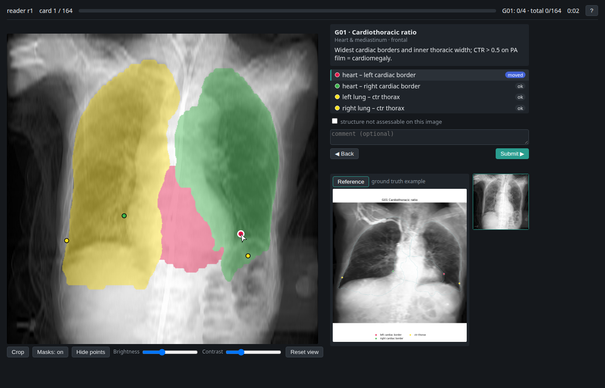

# cxr-landmark-reader

A small local web app in which two readers correct pre-filled anatomical landmarks on chest
radiographs, card by card, to build a gold standard and the per-landmark inter-reader tolerances
used by an object-keypoint-similarity metric.


*The demo and all screenshots use open PAXRay++ images. The app is built for credentialed data
(e.g. MIMIC-CXR): it only binds to localhost, serves images by opaque index, and this repository
contains code only — never images, identifiers or reader data.*

## How reading works
- **Cards.** One card = one image × one landmark group (e.g. *G02 costophrenic angles*). Long
  series are split into level batches (vertebrae T1–4/T5–8/T9–12/L1–2; ribs by side and level),
  and every point of a series is numbered.
- **View.** Small and repeated structures are shown as a zoomed crop around the predicted masks
  (the same framing with or without pre-fill), with a whole-image thumbnail marking the crop. The
  display is aspect-corrected; coordinates are stored in the 512 px frame.
- **Reference.** Every card shows a ground-truth example of its group (PAXRay++ silver landmarks
  with legend, the same colour per landmark as on the card); series groups also show all levels.
- **Assistance.** Toggleable segmentation masks of the card's structures (`m`), brightness and
  contrast, crop/full view (`c`), hold `h` to hide the points. Hovering a landmark shows its rule.
- **Per point.** `ok` by default, drag → `moved`, click to place a missing point → `placed`,
  `n` → not visible, `u` → unsure, `r` → back to the pre-fill. A card-level flag marks a structure
  that cannot be assessed. Images flagged `no_prefill` are read from scratch with a guided
  "Place: …" sequence (anchoring check).
- **Order and blinding.** Group-major (clinical groups first, then vertebrae/ribs, then abstract
  groups), frontal before lateral, images shuffled per reader. Readers only ever see their own
  records. Progress is saved per submit and resumes at the first open card.

| | |
|---|---|
|  |  |
|  |  |
|  |  |

## Setup
```bash
pip install -r requirements.txt
# browser tests / demo recording only:
pip install playwright && python -m playwright install chromium
```

## Building a study
All inputs are passed as paths; nothing is hard-coded. `KP_PREP` is the landmark-definition
repository (taxonomy + extraction rules), `DATA` the study folder (keep it outside any synced or
public location).
```bash
python build/build_vocab.py   --kp-prep $KP_PREP --out $DATA/static \
       --categories $PAXRAY/annotations/test_kp_v1.json                       # vocabulary, groups, definitions
python build/render_refs.py   --vocab $DATA/static/vocab.json \
       --kp-json $PAXRAY/annotations/val_kp_v1.json --image-root $PAXRAY --out $DATA/refs
python build/build_prefill.py --kp-prep $KP_PREP --selection selection.csv --preds preds.pkl \
       --v0-json $PAXRAY/annotations/test_kp.json --vocab $DATA/static/vocab.json \
       --metadata mimic-cxr-2.0.0-metadata.csv.gz --source hybrid \
       --out $DATA/prefill/hybrid_v1 --version hybrid_v1
python build/build_cards.py   --selection selection.csv --prefill $DATA/prefill/hybrid_v1 \
       --vocab $DATA/static/vocab.json --out $DATA/cards.json
```
`selection.csv` needs `dicom_id, path, image (frontal|lateral), no_prefill`. Pre-fill sources:
`hybrid` (learned landmarks where the definition is unchanged and the side labels are consistent,
otherwise the final rules on the predicted masks), `rules_v0masks`, `v1_learned`. The card list
and the pre-fill version are frozen: the server refuses to resume a reader on a different version.

## Reading, aggregation, adjudication
```bash
python -m goldkp.server --data $DATA --images $IMAGE_ROOT --readers r1,r2      # http://127.0.0.1:8765
python aggregate.py --data $DATA --readers r1,r2 --categories $PAXRAY/annotations/test_kp_v1.json \
       --selection selection.csv
python -m goldkp.server --data $DATA --images $IMAGE_ROOT --mode adjudicate
python aggregate.py --data $DATA --readers r1,r2 --categories ... --final
```
`aggregate.py` reports visibility agreement (Cohen's κ, raw agreement, PABAK) and per-landmark
tolerances: with *d* the distance between the readers and *s* = √(mask area),
σ = √(mean(d²/s²)/4), estimated robustly from the median (d²/s² ~ 2σ²χ²₂). Points where both
readers agree within 3√2·σ·s become the mean; visibility conflicts, unsure points and larger
distances go to adjudication (readers shown as A/B in random order). Outputs: `gold_kp_v1.json`
(COCO keypoints keyed by image id, no pixels), `sigma_table.csv`, `agreement_report.md`
(per group, time per card, anchoring check, pre-fill error by source).

**Partial exports.** At any time, finished or not: the *Export* button in the header (the reader's
own annotations) or `python -m goldkp.export --data $DATA --readers r1,r2` writes
`annotations.csv`, `annotations_by_image.json`, `annotations_coco.json` (gold categories; unanswered
landmarks have v = 0) and `summary.json` (progress per group) to `$DATA/exports/<reader>/<time>/` on
the server. `aggregate.py` also runs on a partial study and uses only the cards both readers have
finished.

Remote readers: the server only binds to loopback; use an SSH tunnel (`ssh -L 8765:localhost:8765`).

## Tests
```bash
python -m pytest tests -q                       # unit + API tests on a synthetic study
python build/build_demo.py --kp-json $PAXRAY/annotations/test_kp_v1.json --image-root $PAXRAY \
       --static $DATA/static --refs $DATA/refs --out demo_data
PAXRAY_KP_JSON=$PAXRAY/annotations/test_kp_v1.json python -m pytest e2e -q   # Playwright, headless Chromium
python -m e2e.make_demo --gt $PAXRAY/annotations/test_kp_v1.json             # docs/ screenshots + GIF
```
